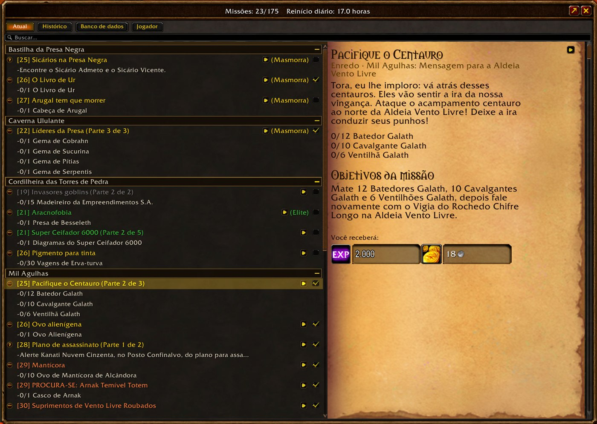
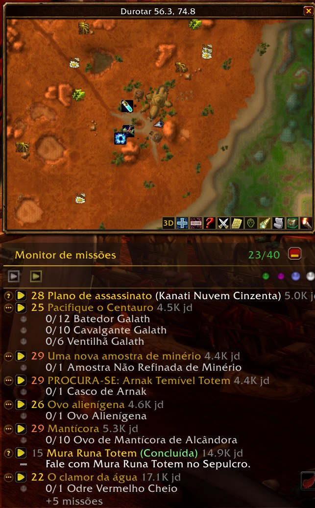

# Carbonite-Forever

🇧🇷 [Português](README.md) | 🇺🇸 **English**

**Carbonite-Forever** brings map, quests, navigation and utilities together in a single addon for **World of Warcraft: Forever** (client 1.60.x, interface 16001).

This is an **unofficial** edition of [Carbonite All in One (Retail & Classic)](https://github.com/IrcDirk/Carbonite-All-in-One-Retail-Classic), maintained by IrcDirk. It ships the full Carbonite plus fixes and features aimed at Forever. For Retail and the other Classic clients, use the official version.

## Differences from the original Carbonite

### Blizzard theme (default)

Carbonite's windows follow the game's own look. New installs start with the Blizzard theme; the other themes are still available in Options > Appearance.

- The game's metal window frame, with a title band and a tool strip; the integrated minimap uses the compact version.
- The game's original font (Friz Quadrata) across the whole addon, including the Quest Watch.
- Menus and pop-ups with the game's tooltip frame and font.
- The game's thin scroll bar on every list and text.
- Tabs with the golden glow of a selected button.
- Quest log in the layout of the original quest log, with the parchment on the details.
- Options inside the game's settings panel (Esc > Options > AddOns > Carbonite-Forever).
- Carbonite button through LibDBIcon, accepted by minimap button collectors.

### New features

| Feature | What it does |
|---|---|
| **Route to the place a guard points to** | When a city guard tells you where a trainer, the bank or another service is, Carbonite marks the NPC on the map through the Guide and draws the route to it. |
| **Dungeon plan with M** | Inside dungeons, the **M** key opens the dungeon plan with the route through the bosses, their portraits, the live minimap and the quests from your log for that place. |
| **Character journey** | A diary of each character's level-ups, completed quests, visited zones, deaths and dungeons. |
| **Destination queue** | Several destinations in a row, with the Destinations window to reorder, go now, remove and reverse them. |
| **Smarter routes** | The route can start with the hearthstone or a mage teleport and, with GatherLite, the walking route goes around mountains and deep water. |
| **Ships, zeppelins and tram** | Transports move on the map, with their schedule at the pier. |
| **Forever quests from QuestieDB** | Carbonite's quest database is missing about 1,300 Forever quests. Carbonite reads these quests from QuestieDB while you play and shows who gives each quest, where to turn it in and the objectives (where the NPCs and objects are and who drops the items). It follows QuestieDB updates without needing a new release of this edition. Quests Carbonite already has are unchanged. |
| **Spoken narration in the quest list** | Carbonite hides Blizzard's quest tracker, which is where Spoken puts its narration button. This edition adds the ▶ button next to each quest's icon in Carbonite's list. It only shows on quests Spoken narrates. |
| **Live minimap in dungeons** | Forever gives no map or position inside dungeons, and Carbonite's map was blank or showed the wrong place. The window now shows Blizzard's live minimap with the dungeon name. The static dungeon map is still in the map menu, under "Dungeon Maps". |
| **In Portuguese** | Fixed texts of the core, quests, notes, warehouse and info windows translated, plus a first-run assistant with a basic options mode. |

## What Carbonite does

### Map
- Replaces the world map with its own window that moves, resizes and adjusts its transparency. It can be docked on screen or full screen (**M** key). Blizzard's original map is still on **Alt+M**.
- Mouse-wheel zoom at the cursor, drag to pan and an option to follow the character.
- The title shows the zone, coordinates and movement speed. Zone tooltips show the level range and faction.
- Integrates Blizzard's minimap into the map window (docked mode) and organizes other addons' minimap buttons.
- In battlegrounds, shows the objectives with timers and quick orders. Hold **Alt** to see player names.
- A lean right-click menu with only day-to-day items (Goto, clear destination, Show..., routes). Scales, transparencies, minimap docking and route radii are in Options > Maps.
- Static dungeon maps in the map menu, from ForeverDungeonJournal, FojjiCore or MapUtils when installed.
- Inside dungeons (the client gives no map or position there), the **M** key opens the dungeon plan with the route to the bosses: a line from the entrance through the bosses, the dead ones faded and the next one highlighted. The live minimap sits in a corner showing where you are, and a side panel lists the bosses in order and the quests from your log for that dungeon, with their objectives. The plan also shows where to turn in those quests, where others start and the quest items found there. In the docked window, the live minimap stays as before.
- API for other addons to draw icons on Carbonite's map ([Map Provider API](Carbonite/Docs/MapProvider.md)).

### Navigation
- **Goto:** mark any point on the map, a coordinate (`/carb goto x y`) or an icon. The map adjusts its zoom to show you and the destination.
- **HUD arrow:** points to the destination and shows its name, distance and estimated time of arrival.
- **Destination queue:** Shift+click on Goto adds the destination without clearing the others; when you arrive, the arrow moves to the next one. The Destinations window (`/carb destinos`, Route... > Destinations... in the map menu or a key binding) lists the queue with zone and distance and lets you move up, move down, go now, remove, reverse and clear.
- **Routes:** path between zones over roads, connections and flight points.
- **Hearthstone and teleports in the route:** when the hearthstone is ready (or, for mages, a teleport to a capital with the rune in your bags) and gets there well ahead, the route starts with it: "Use Hearthstone (place)" and, from there, the usual path. The hearthstone location is recorded when you talk to the innkeeper. Off by default; turn it on in Options > Maps.
- **Walking route around the terrain:** with GatherLite installed, the route line and the HUD arrow go around mountains, cliffs and deep water instead of a straight line. The distance shown is the path's. Turn it off in Options > Maps.
- Compatible with TomTom commands: `/way`, `/cway`, `/wayback`.

### Guide
- A "GPS" of points of interest: trainers, vendors, innkeepers, banks, auction house, flight points, dungeon entrances and more.
- Click to show it on the map and go there, or paste its name and coordinates in chat.

### Quests
- Replaces Blizzard's quest log with its own window. It has a database tab to look up quests you haven't picked up yet.
- Shows on the map who gives each quest (with faction, level, class and prerequisite filters), the objectives and where to turn them in.
- **Quest list** (Quest Watch): shows objectives and progress, the quest item to use with one click and the distance. It has an automatic mode that tracks the closest quest.
- Tracks each objective with a button: the map and the HUD arrow point to it.
- Shows party quests, shares quests and sends yours to other Carbonite users.
- NPC and item tooltips show which quests in your log they count for.
- Plays a sound and announces when a quest is completed.

### Gathering
- Records where you gathered herbs, mined, fished and opened treasure, and shows the nodes on the map and minimap.
- With [GatherLite](https://www.curseforge.com/wow/addons/gatherlite) installed, the map shows only its nodes: its database and what you gathered. Without it, the map shows the nodes you gathered yourself.

### Warehouse
- Inventory of all your characters: bags, bank, equipment, professions and money, in a single window.
- Item tooltips show how many of that item each character has.

### Notes and favorites
- Map notes at any point, organized in folders, with their own icons.
- Integrations that bring HandyNotes, RareScanner, GatherLite, RestedXP (RXP), Questie and Attune points, and the Zygor and RXP arrows, to Carbonite's map.

### Info windows
- Up to six small configurable windows with text info: your and your target's health and mana, coordinates, durability, money and more.

### Social
- **Pals:** follows your friends across all your characters and groups the characters of the same person.
- **Punks:** records enemy players who attacked you and warns when they are nearby.
- Shows the party, the raid and other Carbonite users (friends and guild) on the map.

### More
- **Character journey:** a diary with the date, time and zone of each level-up, completed quest, first visit to a zone, death and dungeon, per character (the 500 most recent). Open it with `/carb jornada` or from the minimap button menu; turn it off in Options > General.
- Currency tracking, mail notice, durability alert, auction help and combat statistics.
- Settings profiles, data export and import, and settings transfer between characters.

## Requirements

- **World of Warcraft: Forever** 1.60.x (interface 16001).
- **QuestieDB** (required): the Forever quest database, maintained by the Questie team. Without it, about 1,300 Forever quests are missing from the map, the quest log and the tracker. Install the latest Forever version and enable only QuestieDB; Questie itself can stay off. Inside dungeons, the **M** key panel also lists the quests from your log that QuestieDB places there and the objective items that drop there (QuestieDB has no positions inside dungeons, so they don't go on the plan).
- Optional:
  - **Spoken** (with the Spoken_Quests module): needed for the narration button in the quest list.
  - **ForeverDungeonJournal** or **FojjiCore:** dungeon plan (art, bosses and route order; FojjiCore also knows which bosses are dead). Read while you play; Carbonite does not copy this data.
  - **[GatherLite](https://www.curseforge.com/wow/addons/gatherlite):** provides the terrain data used by the walking route around the terrain. Without it, the route is a straight line.
  - **[MapUtils](https://www.curseforge.com/projects/1463967):** dungeon art when neither ForeverDungeonJournal nor FojjiCore has the dungeon. Without any of the three, the **M** key shows the live minimap and the boss panel (Carbonite's boss data comes from MapUtils and does not need it installed).

## Installation

1. Close WoW.
2. Delete the `Carbonite`, `Carbonite.Quests`, `Carbonite.Info`, `Carbonite.Notes`, `Carbonite.Warehouse` and, if present, `Carbonite.Gathermate2_Data` folders from `World of Warcraft\_forever_\Interface\AddOns`.
3. Download the zip of the latest version from the [Releases](https://github.com/Alexsir-Wolf/Carbonite-Forever/releases) page and extract it into `Interface\AddOns`.
4. Install the Forever **QuestieDB** into `Interface\AddOns` if you don't have it yet, and keep it up to date.
5. If you use an addon manager (CurseForge, WowUp, etc.), turn off updates for the official Carbonite there. Otherwise, the next official update replaces this edition.

Your official Carbonite settings keep working, because the internal names are the same.

## Automatic updates

Each GitHub release has the `Carbonite-Forever-<version>.zip` zip, with all the `Carbonite*` folders, and the `release.json` that managers read. This way, the manager installs and updates the Forever edition straight from GitHub.

- **WowUp:** in *Get Addons*, click *Install from URL*, paste `https://github.com/Alexsir-Wolf/Carbonite-Forever` and install. New releases show up as updates.
- **Other managers** that accept GitHub repositories (CurseBreaker, Ajour and the like): add the same URL.

Before that, delete the official Carbonite folders (installation step 2) and remove the official Carbonite from the manager's list, so one doesn't overwrite the other.

### Publishing a release (maintainers)

1. Update `CHANGELOG-FOREVER.md`; it becomes the release text.
2. Create and push a tag in the edition's own numbering, `v<major>.<minor>.<patch>`, for example `git tag -a v1.0.1 -m v1.0.1 && git push origin v1.0.1`.
3. The `Release` workflow runs [BigWigsMods/packager](https://github.com/BigWigsMods/packager), replaces `@project-version@` in the `.toc` files with the tag and publishes the release with the zip. Upstream tags (such as `v12.1.0-00023`) publish nothing.

Uploading to CurseForge and Wago is optional and only happens if the project exists there. To turn it on:

1. Create the Forever edition project on the site. Never use the official Carbonite id: the manager would swap one edition for the other.
2. Add the id to `Carbonite/Carbonite.toc` and its variants (`Carbonite-Camelot.toc`, etc.): `## X-Curse-Project-ID: <id>` for CurseForge and `## X-Wago-ID: <id>` for Wago.
3. In the repository's *Settings > Secrets and variables > Actions*, create the `CF_API_KEY` secret (CurseForge token) or `WAGO_API_TOKEN` (Wago token).

Without the id or the secret, the packager skips that site and the GitHub release goes out normally.

## Commands

| Command | What it does |
|---|---|
| `/carb` or `/carb ajuda` | Lists the commands (`/cb` also works) |
| `/carb menu` | Carbonite main menu |
| `/carb options` | Options |
| `/carb goto <x> <y>` | Sets a destination in the current zone |
| `/carb resetwindows` | Moves the windows back to their default position |
| `/carb jornada` | Character journey (levels, quests, zones, deaths and dungeons) |
| `/carb destinos` | Destination queue window (reorder, go now, remove, reverse) |
| `/carb debug` | Diagnostic commands, such as `profiler` |
| `/way x y` | Destination in TomTom format |

## Developer documentation

- [Architecture](Carbonite/Docs/Architecture.md): code organization, plugins and the map subsystem.
- [Map Provider API](Carbonite/Docs/MapProvider.md): how other addons draw icons on Carbonite's map.

## Credits and license

- **Carbonite** was created by Carbon Based Creations. CARBONITE is a registered trademark of Carbon Based Creations, LLC; this edition is not affiliated with the company.
- Carbonite is now maintained by the community. This edition is based on the work of **IrcDirk** and the contributors of [Carbonite All in One](https://github.com/IrcDirk/Carbonite-All-in-One-Retail-Classic).
- The changes in this edition are by **Alexsir-Wolf**. The full list is in this repository's commit history.
- Forever quest data belongs to the Questie team and is read from the QuestieDB you installed. This edition does not copy that data.
- The Guide's meeting stones (`Carbonite/Data/camelot/Guides/MeetingStone.lua`) come from the **QuestieDB** (Forever) object database, also under GPL v3.
- Each zone's fishing skill (`Carbonite/Modules/Map/ZoneFishing.lua`), the Guide's spirit healers (`Carbonite/Data/camelot/Guides/SpiritHealer.lua`) and the library books and convergences (`Carbonite.Notes/Integrations/ForeverPoints.lua`) come from **MapUtils**, by D4KiR, also under GPL v3. The dungeon floors, entrances, bosses, quests and quest items (`Carbonite/Modules/Map/DungeonPins.lua`, from `shared/InstancePins` and `data/*/instances.lua`) also come from it, with the English names in `Carbonite/Locales/*/Dungeons.lua`, used only when the client doesn't provide its own.
- The routes and periods of the ships, zeppelins and tram (`Carbonite/Data/camelot/Transports.lua`), their icons (`Carbonite/Gfx/Map/Transports/`) and the position and schedule calculation (`Carbonite/Modules/Map/Transports.lua`) also come from **MapUtils**, by D4KiR, under GPL v3.
- The walking pathfinding (`Carbonite/Libs/GroundNav/`) comes from **[Shortest Path Forever](https://github.com/cjber/shortest-path-forever)**, by Cillian Berragan and contributors, under GPL v3 or later, in the adapted copy GatherLite ships. The terrain data does not ship with Carbonite: it is read from GatherLite while you play.
- License: [GNU GPL v3](LICENSE). The code remains open, and changes must keep the same license.

### Support Carbonite

Carbonite All in One is maintained by IrcDirk. To support its development:

 or 
