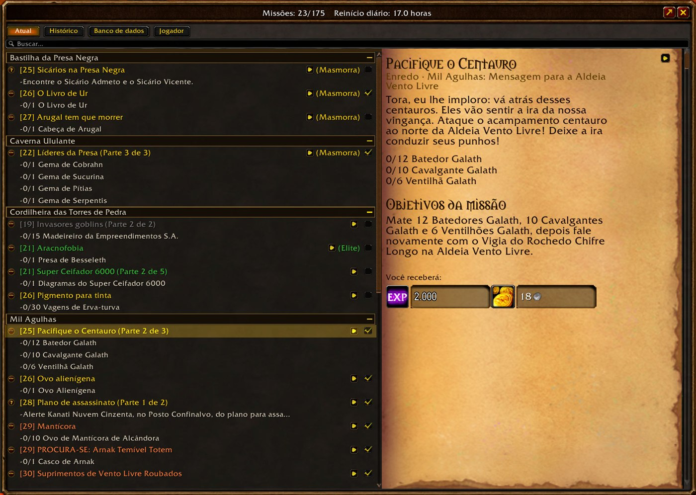
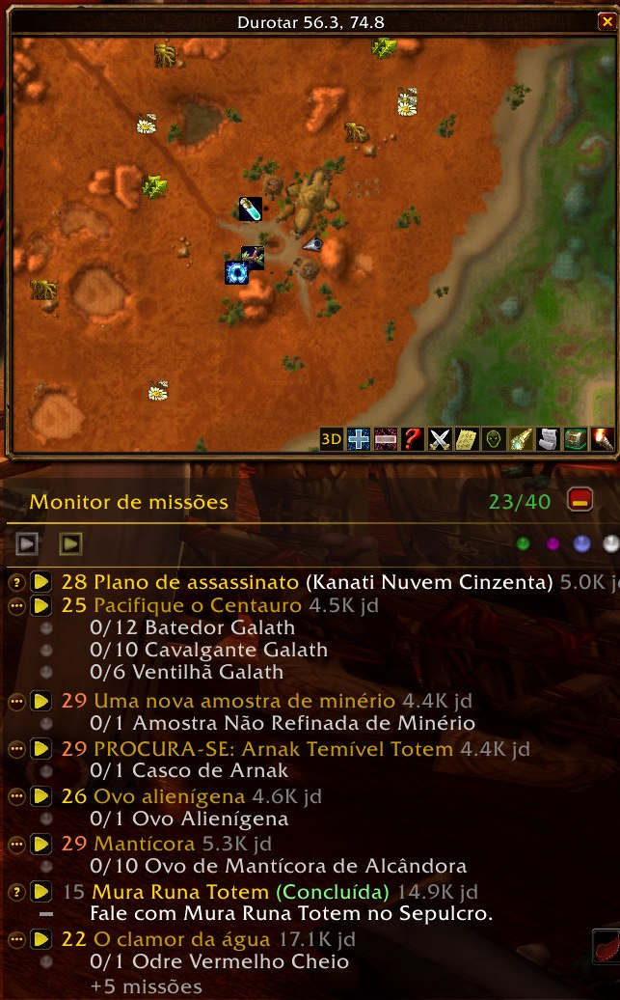

# Carbonite-Forever

🇧🇷 **Português** | 🇺🇸 [English](README.en-US.md)

O **Carbonite-Forever** reúne mapa, quests, navegação e utilidades num só addon para o **World of Warcraft: Forever** (cliente 1.60.x, interface 16001).

Esta é uma edição **não oficial** do [Carbonite All in One (Retail & Classic)](https://github.com/IrcDirk/Carbonite-All-in-One-Retail-Classic), mantido por IrcDirk. Ela traz o Carbonite completo mais correções e recursos voltados ao Forever. Para Retail e para os outros clientes Classic, use a versão oficial.

## Diferenças do Carbonite original

### Tema Blizzard (padrão)

As janelas do Carbonite seguem o visual do próprio jogo. Em instalações novas o tema Blizzard já vem ligado; os outros temas continuam em Opções > Aparência.

- Moldura metálica das janelas do jogo, com faixa de título e faixa de ferramentas; o minimapa integrado usa a versão compacta.
- Fonte original do jogo (Friz Quadrata) em todo o addon, inclusive no Monitor de missões.
- Menus e pop-ups com a moldura e a fonte do tooltip do jogo.
- Barra de rolagem fina do jogo em todas as listas e textos.
- Abas com o brilho dourado de botão selecionado.
- Diário de missões no layout do diário original, com o pergaminho nos detalhes.
- Opções dentro do painel de configurações do jogo (Esc > Opções > AddOns > Carbonite-Forever).
- Botão do Carbonite pelo LibDBIcon, aceito pelos coletores de botões de minimapa.

### Recursos novos

| Recurso | O que faz |
|---|---|
| **Rota até o lugar indicado pelo guarda** | Quando o guarda da cidade indica onde fica um instrutor, um banco ou outro serviço, o Carbonite marca o NPC no mapa pelo Guia e traça a rota até ele. |
| **Planta da masmorra com M** | Dentro de masmorras, a tecla **M** abre a planta com a rota pelos chefes, os retratos, o minimapa ao vivo e as quests do seu registro para aquele lugar. |
| **Jornada do personagem** | Diário com as subidas de nível, quests concluídas, zonas visitadas, mortes e masmorras de cada personagem. |
| **Fila de destinos** | Vários destinos em sequência, com a janela Destinos para ordenar, ir agora, remover e inverter. |
| **Rotas mais espertas** | A rota pode começar pela pedra de regresso ou por um teleporte de mago e, com o GatherLite, a rota a pé contorna montanhas e água funda. |
| **Navios, zepelins e bonde** | Os transportes aparecem em movimento no mapa, com o horário no píer. |
| **Quests do Forever a partir do QuestieDB** | A base de quests do Carbonite não tem cerca de 1.300 quests do Forever. O Carbonite lê essas quests do QuestieDB durante o jogo e mostra quem dá cada quest, onde entregar e os objetivos (onde ficam os NPCs, os objetos e quem dropa os itens). Acompanha as atualizações do QuestieDB sem precisar de uma versão nova desta edição. As quests que o Carbonite já tem não mudam. |
| **Narração do Spoken na lista de quests** | O Carbonite esconde o rastreador de missões da Blizzard, que é onde o Spoken põe o botão de narração. Esta edição coloca o botão ▶ ao lado do ícone de cada quest na lista do Carbonite. Ele só aparece nas quests que o Spoken narra. |
| **Minimapa ao vivo em masmorras** | O Forever não informa mapa nem posição dentro de masmorras, e o mapa do Carbonite ficava em branco ou mostrava o lugar errado. Agora a janela mostra o minimapa da Blizzard ao vivo, com o nome da masmorra. O mapa estático da masmorra continua no menu do mapa, em "Dungeon Maps". |
| **Distância em metros** | Com o jogo em português, a seta, o mapa, o Guia, a lista de destinos e o monitor de quests mostram a distância em metros e quilômetros ("319 m", "1,3 km"). Uma jarda conta como um metro, como no alcance das magias. A unidade se escolhe em Opções > Rastreamento. |
| **Ícones do mapa atuais** | Os pontos do Guia usam os ícones atuais da Blizzard quando o jogo os tem e, nos outros, o desenho sem a moldura antiga. O assistente pergunta qual visual usar: atual, clássico ou, com o HandyNotes e o MapNotes instalados, os ícones do MapNotes. |
| **Em português** | Textos fixos do núcleo, das quests, das notas, do armazém e das janelas de informação traduzidos, e um assistente de primeira execução com modo básico de opções. |

## O que o Carbonite faz

### Mapa
- Substitui o mapa do mundo por uma janela própria que se move, redimensiona e ajusta a transparência. Pode ficar acoplada à tela ou em tela cheia (tecla **M**). O mapa original da Blizzard continua em **Alt+M**.
- Zoom com a roda do mouse na posição do cursor, arrasto para navegar e opção de seguir o personagem.
- Mostra no título a zona, as coordenadas e a velocidade de movimento. Os tooltips das zonas mostram a faixa de nível e a facção.
- Integra o minimapa da Blizzard à janela do mapa (modo acoplado) e organiza os botões de minimapa de outros addons.
- Em battlegrounds, mostra os objetivos com timers e ordens rápidas. Segure **Alt** para ver os nomes dos jogadores.
- Menu do botão direito enxuto, só com o uso do dia a dia (Goto, limpar destino, Mostrar..., rotas). Escalas, transparências, encaixe do minimapa e raios de rota ficam em Opções > Mapas.
- Mapas de masmorra estáticos no menu do mapa, a partir do ForeverDungeonJournal, do FojjiCore ou do MapUtils, quando instalados.
- Dentro de masmorras (o cliente não dá mapa nem posição lá), a tecla **M** abre a planta da masmorra com a rota até os chefes: linha da entrada passando pelos chefes, os mortos apagados e o próximo destacado. O minimapa ao vivo fica num canto, mostrando onde você está, e um painel ao lado lista os chefes na ordem e as quests do seu registro para aquela masmorra, com os objetivos. Na planta aparecem também onde entregar essas quests, onde começam outras e os itens de quest que ficam ali. Na janela acoplada, o minimapa ao vivo continua como antes.
- API para outros addons desenharem ícones no mapa do Carbonite ([Map Provider API](Carbonite/Docs/MapProvider.md)).

### Navegação
- **Goto:** marque qualquer ponto do mapa, uma coordenada (`/carb goto x y`) ou um ícone. O mapa ajusta o zoom para mostrar você e o destino; se você mudar o zoom, ele fica como você deixou até a rota acabar.
- **Seta HUD:** aponta para o destino e mostra nome, distância (em metros com o jogo em português) e tempo estimado de chegada.
- **Fila de destinos:** Shift+clique em Goto adiciona o destino sem apagar os outros; ao chegar, a seta passa ao próximo. A janela Destinos (`/carb destinos`, Rota... > Destinos... no menu do mapa ou um atalho de teclado) lista a fila com zona e distância e permite subir, descer, ir agora, remover, inverter e limpar.
- **Rotas:** caminho entre zonas por estradas, conexões e pontos de voo.
- **Pedra de regresso e teleportes na rota:** quando a pedra está pronta (ou, para magos, um teleporte para uma capital com a runa na bolsa) e chega bem antes, a rota começa por ela: "Usar Pedra de Regresso (lugar)" e, dali, o caminho de sempre. O lugar da pedra é gravado quando você fala com o estalajadeiro. Vem desligada por padrão; liga em Opções > Mapas.
- **Rota a pé que contorna o terreno:** com o GatherLite instalado, a linha da rota e a seta do HUD desviam de montanhas, penhascos e água funda, em vez de seguir em linha reta. A distância mostrada é a do caminho. Desliga em Opções > Mapas.
- Compatível com os comandos do TomTom: `/way`, `/cway`, `/wayback`.

### Guia
- Um "GPS" de pontos de interesse: instrutores, vendedores, estalajadeiros, bancos, leilão, pontos de voo, entradas de masmorra e mais.
- Clique para mostrar no mapa e ir até o ponto, ou cole o nome e as coordenadas no chat.
- Ícones atuais da Blizzard ou sem a moldura antiga; "Ícones clássicos" em Opções do Mapa volta ao visual antigo. Com os ícones do MapNotes escolhidos no assistente, os treinadores e serviços aparecem no mapa só com os ícones dele, e a lista do Guia continua guiando até eles.

### Quests
- Substitui o diário de quests da Blizzard por uma janela própria. Tem uma aba de banco de dados para consultar quests que você ainda não pegou.
- Mostra no mapa quem dá cada quest (com filtros de facção, nível, classe e quests anteriores), os objetivos e onde entregar.
- **Lista de quests** (Monitor de missões): mostra objetivos e progresso, o item da quest para usar com um clique e a distância. Tem um modo automático que rastreia a quest mais próxima.
- Rastreia cada objetivo com um botão: o mapa e a seta HUD apontam para ele.
- Mostra as quests do grupo, compartilha quests e envia as suas a outros usuários do Carbonite.
- Os tooltips de NPCs e itens mostram para quais quests da sua lista eles contam.
- Toca um som e avisa quando uma quest é completada.

### Coleta
- Registra onde você colheu ervas, minerou, pescou e abriu tesouros, e mostra os nós no mapa e no minimapa.
- Com o [GatherLite](https://www.curseforge.com/wow/addons/gatherlite) instalado, mostra só os nós dele no mapa: a base dele e o que você coletou. Sem ele, mostra os nós que você mesmo coletou.

### Warehouse
- Inventário de todos os seus personagens: bolsas, banco, equipamento, profissões e dinheiro, em uma janela só.
- Mostra nos tooltips quantas unidades de um item cada personagem tem.

### Notas e favoritos
- Notas no mapa em qualquer ponto, organizadas em pastas, com ícones próprios.
- Integrações que trazem para o mapa do Carbonite os pontos de HandyNotes, RareScanner, GatherLite, RestedXP (RXP), Questie, Attune e as setas do Zygor e do RXP.

### Janelas de informação
- Até seis janelas pequenas e configuráveis com informações em texto: vida e mana suas e do alvo, coordenadas, durabilidade, dinheiro e outras.

### Social
- **Pals:** acompanha seus amigos em todos os seus personagens e agrupa os personagens de uma mesma pessoa.
- **Punks:** registra jogadores inimigos que atacaram você e avisa quando aparecem por perto.
- Mostra no mapa o grupo, a raid e outros usuários do Carbonite (amigos e guilda).

### Mais
- **Jornada do personagem:** diário com data, hora e zona de cada subida de nível, quest concluída, primeira visita a uma zona, morte e masmorra, por personagem (as 500 mais recentes). Abre com `/carb jornada` ou pelo menu do botão do minimapa; desliga em Opções > Geral.
- Rastreamento de moedas, aviso de correio, alerta de durabilidade, ajuda no leilão e estatísticas de combate.
- Perfis de configuração, exportar e importar dados e transferir configurações entre personagens.

## Requisitos

- **World of Warcraft: Forever** 1.60.x (interface 16001).
- **QuestieDB** (obrigatório): a base de quests do Forever, mantida pela equipe do Questie. Sem ele, faltam cerca de 1.300 quests do Forever no mapa, no diário e no monitor. Instale a versão mais recente para o Forever e ative só o QuestieDB; o Questie pode ficar desligado. Dentro de masmorras, o painel da tecla **M** também lista as quests do registro que o QuestieDB põe ali e os itens de objetivo que caem lá (o QuestieDB não tem posições dentro de masmorras, então elas não vão para a planta).
- Opcionais:
  - **Spoken** (com o módulo Spoken_Quests): necessário para o botão de narração na lista de quests.
  - **ForeverDungeonJournal** ou **FojjiCore:** planta da masmorra (arte, chefes e a ordem da rota; o FojjiCore também sabe os chefes mortos). Lidos durante o jogo; o Carbonite não copia esses dados.
  - **[GatherLite](https://www.curseforge.com/wow/addons/gatherlite):** traz os dados de terreno usados pela rota a pé que contorna o terreno. Sem ele, a rota segue em linha reta.
  - **[HandyNotes](https://www.curseforge.com/wow/addons/handynotes)** com **[HandyNotes: MapNotes](https://www.curseforge.com/wow/addons/mapnotes):** os pontos dos plugins do HandyNotes aparecem no mapa do Carbonite. Com o MapNotes, dá para escolher os ícones dele no assistente de configuração. O Carbonite não copia a arte: sem os dois, ficam os ícones do próprio Carbonite.
  - **[MapUtils](https://www.curseforge.com/projects/1463967):** arte das masmorras quando nem o ForeverDungeonJournal nem o FojjiCore têm a masmorra. Sem nenhum dos três, a tecla **M** mostra o minimapa ao vivo e o painel com os chefes (os dados de chefes do Carbonite vêm do MapUtils e não dependem dele instalado).

## Instalação

1. Feche o WoW.
2. Apague as pastas `Carbonite`, `Carbonite.Quests`, `Carbonite.Info`, `Carbonite.Notes`, `Carbonite.Warehouse` e, se existir, `Carbonite.Gathermate2_Data` de `World of Warcraft\_forever_\Interface\AddOns`.
3. Baixe o zip da versão mais recente na página de [Releases](https://github.com/Alexsir-Wolf/Carbonite-Forever/releases) e extraia em `Interface\AddOns`.
4. Instale o **QuestieDB** do Forever em `Interface\AddOns`, se ainda não tiver, e mantenha-o atualizado.
5. Se você usa um gerenciador de addons (CurseForge, WowUp etc.), desligue as atualizações do Carbonite oficial nele. Senão, a próxima atualização oficial substitui esta edição.

As configurações do Carbonite oficial continuam valendo, porque os nomes internos são os mesmos.

## Atualização automática

Cada release no GitHub traz o zip `Carbonite-Forever-<versão>.zip`, com todas as pastas `Carbonite*`, e o `release.json` que os gerenciadores leem. Assim, o gerenciador instala e atualiza a edição Forever direto do GitHub.

- **WowUp:** em *Get Addons*, clique em *Install from URL*, cole `https://github.com/Alexsir-Wolf/Carbonite-Forever` e instale. Novas releases aparecem como atualização.
- **Outros gerenciadores** que aceitam repositórios do GitHub (CurseBreaker, Ajour e afins): adicione a mesma URL.

Antes, apague as pastas do Carbonite oficial (passo 2 da instalação) e tire o Carbonite oficial da lista do gerenciador, para que um não sobrescreva o outro.

### Publicar uma release (mantenedores)

1. Atualize o `CHANGELOG-FOREVER.md`; ele vira o texto da release.
2. Crie e envie uma tag na numeração própria da edição, `v<maior>.<menor>.<correção>`, por exemplo `git tag -a v1.0.1 -m v1.0.1 && git push origin v1.0.1`.
3. O workflow `Release` roda o [BigWigsMods/packager](https://github.com/BigWigsMods/packager), troca `@project-version@` nos `.toc` pela tag e publica a release com o zip. Tags do upstream (como `v12.1.0-00023`) não publicam nada.

O envio para a CurseForge e a Wago é opcional e só acontece se o projeto existir lá. Para ligar:

1. Crie o projeto da edição Forever no site. Nunca use o id do Carbonite oficial: o gerenciador trocaria uma edição pela outra.
2. Adicione o id no `Carbonite/Carbonite.toc` e nas variantes (`Carbonite-Camelot.toc` etc.): `## X-Curse-Project-ID: <id>` para a CurseForge e `## X-Wago-ID: <id>` para a Wago.
3. Em *Settings > Secrets and variables > Actions* do repositório, crie o secret `CF_API_KEY` (token da CurseForge) ou `WAGO_API_TOKEN` (token da Wago).

Sem o id ou sem o secret, o packager pula aquele site e a release no GitHub sai normalmente.

## Comandos

| Comando | O que faz |
|---|---|
| `/carb` ou `/carb ajuda` | Lista os comandos (`/cb` também funciona) |
| `/carb menu` | Menu principal do Carbonite |
| `/carb options` | Opções |
| `/carb goto <x> <y>` | Marca um destino na zona atual |
| `/carb resetwindows` | Volta as janelas para a posição padrão |
| `/carb jornada` | Jornada do personagem (níveis, quests, zonas, mortes e masmorras) |
| `/carb destinos` | Janela da fila de destinos (ordenar, ir agora, remover, inverter) |
| `/carb debug` | Comandos de diagnóstico, como o `profiler` |
| `/way x y` | Destino no formato do TomTom |

## Documentação para desenvolvedores

- [Arquitetura](Carbonite/Docs/Architecture.md): organização do código, plugins e subsistema do mapa.
- [Map Provider API](Carbonite/Docs/MapProvider.md): como outros addons desenham ícones no mapa do Carbonite.

## Créditos e licença

- **Carbonite** foi criado pela Carbon Based Creations. CARBONITE é uma marca registrada da Carbon Based Creations, LLC; esta edição não tem relação com a empresa.
- Hoje o Carbonite é mantido pela comunidade. Esta edição se baseia no trabalho de **IrcDirk** e dos colaboradores do [Carbonite All in One](https://github.com/IrcDirk/Carbonite-All-in-One-Retail-Classic).
- As mudanças desta edição são de **Alexsir-Wolf**. A lista completa está no histórico de commits deste repositório.
- Os dados de quests do Forever pertencem à equipe do Questie e são lidos do QuestieDB que você instalou. Esta edição não copia esses dados.
- As pedras de encontro do Guia (`Carbonite/Data/camelot/Guides/MeetingStone.lua`) vêm da base de objetos do **QuestieDB** (Forever), também sob a GPL v3.
- A perícia de pesca de cada zona (`Carbonite/Modules/Map/ZoneFishing.lua`), os curandeiros espirituais do Guia (`Carbonite/Data/camelot/Guides/SpiritHealer.lua`) e os livros da biblioteca e convergências (`Carbonite.Notes/Integrations/ForeverPoints.lua`) vêm do **MapUtils**, de D4KiR, também sob a GPL v3. Também vêm dele os andares, entradas, chefes, quests e itens de quest das masmorras (`Carbonite/Modules/Map/DungeonPins.lua`, de `shared/InstancePins` e `data/*/instances.lua`), com os nomes em inglês em `Carbonite/Locales/*/Dungeons.lua`, usados só quando o cliente não dá o nome dele.
- As rotas e períodos dos navios, zepelins e bonde (`Carbonite/Data/camelot/Transports.lua`), os ícones deles (`Carbonite/Gfx/Map/Transports/`) e o cálculo de posição e horário (`Carbonite/Modules/Map/Transports.lua`) também vêm do **MapUtils**, de D4KiR, sob a GPL v3.
- A busca de caminho a pé (`Carbonite/Libs/GroundNav/`) vem do **[Shortest Path Forever](https://github.com/cjber/shortest-path-forever)**, de Cillian Berragan e colaboradores, sob a GPL v3 ou posterior, na cópia adaptada que o GatherLite distribui. Os dados de terreno não vêm com o Carbonite: são lidos do GatherLite durante o jogo.
- Os níveis das zonas novas, as entradas das masmorras novas (com as segundas entradas) e as pedras de encontro da Drowned City e da Excavation Site (`Carbonite/Data/camelot/Zones.lua`, `Carbonite/Data/camelot/Guides/MeetingStone.lua`) vêm do **MapUtils**, de D4KiR, sob a GPL v3, conferidos com o ForeverDungeonJournal. Os voos de Rog'mar, Summit of Eternity e Tainted Foothills (`Carbonite/Data/camelot/Guides/FlightMaster.lua`), a doca de Southshore, a chegada do portal de Dalaran e as passagens provisórias para Hyjal e Shen'dralas (`Carbonite/Data/camelot/ZoneConnections.lua`) vêm do **Shortest Path Forever**, sob a GPL v3 ou posterior.
- Licença: [GNU GPL v3](LICENSE). O código continua aberto, e as mudanças precisam manter a mesma licença.

### Apoie o Carbonite

O Carbonite All in One é mantido por IrcDirk. Para apoiar o desenvolvimento dele:

 ou 
